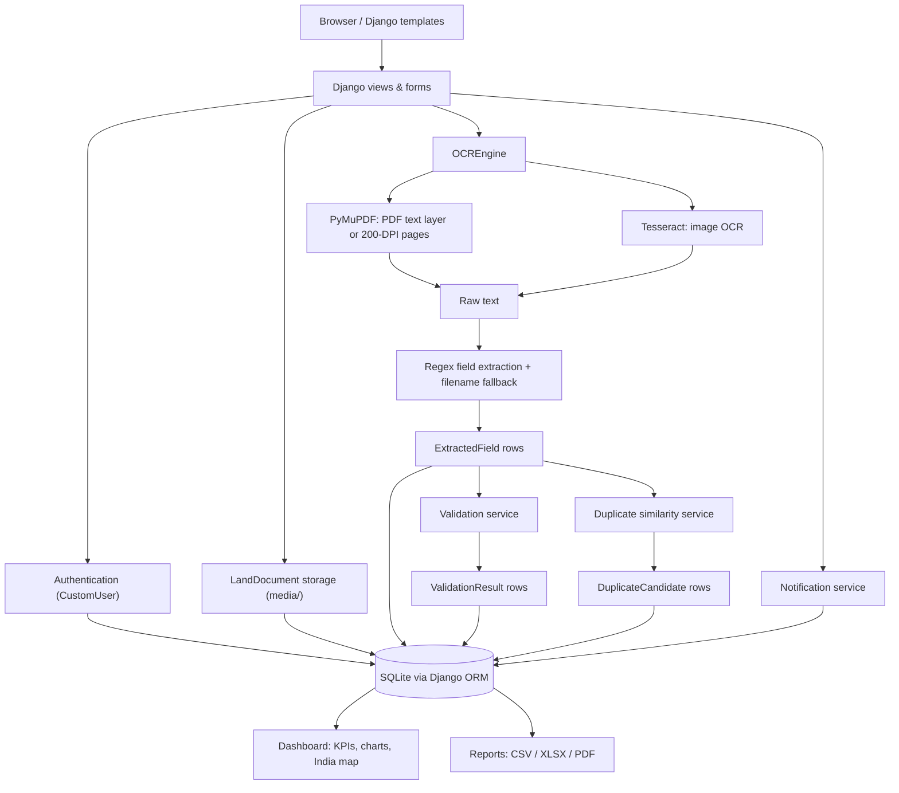
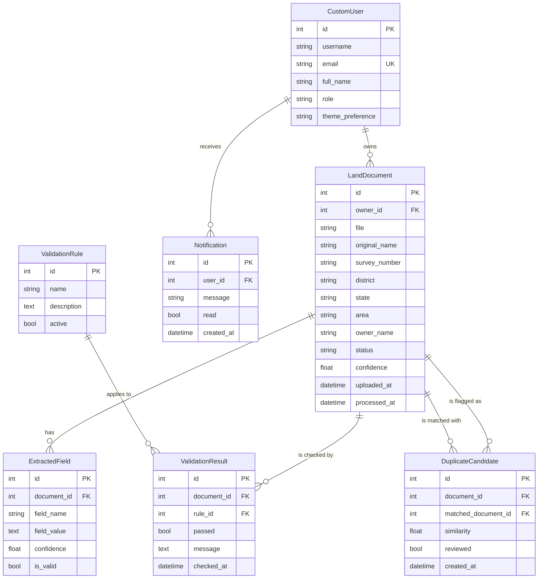

# BhoomiAI – Smart Land Record Digitization and Validation System


BhoomiAI is a Django web application for digitizing Indian land records. It accepts scanned documents (Record of Rights, khasra extracts and plot documents) as PDFs or images, extracts key fields with OCR, converts them into structured records, applies rule-based validation, flags probable duplicates, and produces CSV, Excel and PDF reports.

The project is built for local deployment and demonstration. It ships with a complete working data pipeline, a responsive dashboard with charts and a state-level India map, and a Django admin configured for all custom models.

> **Status:** Functional end-to-end for development/demo use. The bundled settings are development settings and are not hardened for public production deployment. See [Security and Limitations](#security-and-limitations).

---

## Table of Contents

- [Introduction](#introduction)
- [Project Overview](#project-overview)
- [Key Features](#key-features)
- [Technology Stack](#technology-stack)
- [Project Architecture](#project-architecture)
- [Installation and Setup](#installation-and-setup)
- [Environment Variables and Configuration](#environment-variables-and-configuration)
- [Database Design](#database-design)
- [OCR and Validation Workflow](#ocr-and-validation-workflow)
- [Application Routes](#application-routes)
- [Application Screenshots](#application-screenshots)
- [Project Directory Structure](#project-directory-structure)
- [Testing](#testing)
- [Troubleshooting](#troubleshooting)
- [Security and Limitations](#security-and-limitations)
- [Future Improvements](#future-improvements)
- [Contributing](#contributing)
- [License](#license)
- [Author and Project Links](#author-and-project-links)

---

## Introduction

### The problem

Land records in India are frequently stored as scanned paper documents, PDFs and legacy images. Survey numbers, district names, land area and owner names have to be read manually, retyped into registers and cross-checked between departments. This is slow, error-prone and makes duplicate or incomplete records difficult to detect.

### What BhoomiAI does

BhoomiAI provides a single workspace that:

- stores uploaded land-record files against a user account;
- reads text from digital PDFs or scanned images using OCR;
- extracts four core fields — **Survey Number**, **District**, **Area** and **Owner Name** — with per-field confidence scores;
- runs five rule-based validation checks (field completeness, numeric area and OCR quality);
- scores document pairs for likely duplication using survey number, district, owner and area similarity;
- exposes a dashboard with document statistics, 30-day upload trends, status distribution, top districts and an interactive state map;
- exports the workspace as CSV, Excel (`.xlsx`) or PDF;
- records in-app notifications for upload, OCR and deletion events.

### Practical applications

- Revenue and land-records departments digitizing paper registers.
- Registries and land banks performing first-pass quality checks.
- Demonstrations and training environments where realistic sample records are needed.

The word “AI” in the product name refers to the OCR-driven extraction and rule-based analysis implemented here. No trained machine-learning model is included in this repository.

---

## Project Overview

The implemented workflow is:

1. **Upload** — An authenticated user uploads a PDF or image through `/documents/upload/`. The upload form enforces a file-type whitelist and a 10 MB size limit.
2. **Store** — A `LandDocument` row is created, owned by the uploading user. The file is stored under `media/documents/<year>/<month>/`. The district can be used to infer the state automatically.
3. **Run OCR** — The user opens the record and clicks **Run OCR**. `OCREngine` extracts text and then structured fields.
4. **Structure fields** — Four `ExtractedField` rows (Survey Number, District, Area, Owner Name) are created with confidence values. Missing fields are stored as `Not detected`.
5. **Validate** — `validate_document()` re-runs the active validation rules and stores `ValidationResult` rows for every check.
6. **Detect duplicates** — `find_duplicates()` compares the document against the user’s other documents and creates `DuplicateCandidate` rows above a similarity threshold.
7. **Review** — The document detail page shows the original file, extracted fields with confidence bars, rule results and duplicate candidates. Re-running OCR or validation is available from the same page.
8. **Persist** — Documents, fields, validation results, duplicates and notifications are stored in SQLite through the Django ORM.
9. **Report** — The Reports page generates CSV, Excel and PDF exports from the stored records.

OCR, validation and duplicate detection run **synchronously inside the HTTP request**; there is no background worker or task queue.

---

## Key Features

### Implemented

| Feature | Implementation |
|---|---|
| User registration | `SignupForm` + `SignupView`; email is the login identifier, username is derived from the email |
| Login / logout | Django `LoginView` and `LogoutView`; logout is a CSRF-protected POST form |
| Profile | View account details and workspace counters; edit full name and theme preference |
| Theme switching | Light/dark theme toggle persisted in `localStorage`, with server-side `theme_preference` on the profile |
| Document upload | PDF, PNG, JPG/JPEG, TIFF, BMP, WEBP; maximum 10 MB |
| Document list | Owner-scoped listing with text search (file name / survey number) and status filter |
| PDF and image processing | PyMuPDF for PDF text layers and 200-DPI rasterization; Pillow for images |
| OCR extraction | Tesseract through `pytesseract`, with a filename-based fallback when little text is found |
| Structured fields | Survey Number, District, Area, Owner Name stored as `ExtractedField` rows with confidence |
| State inference | District-to-state mapping for 38 Indian district names covering 15 states/UTs (e.g. Pune → Maharashtra, Patna → Bihar) |
| Validation engine | Five default rules, re-runnable per document or for all documents |
| Duplicate detection | Weighted similarity scoring; configurable threshold of `0.6`; scan-all and review actions |
| Dashboard | KPI cards, 30-day trend, status doughnut, top-5 district bar chart, sparklines and workflow progress |
| India map | Leaflet map with state bubbles, a local GeoJSON boundary overlay and click-to-filter (`?state=`) |
| Notifications | Per-user in-app notifications with unread badge, mark-read and mark-all-read |
| Reports | CSV (UTF-8 BOM), styled Excel workbook, landscape A4 PDF; automatic CSV fallback if a library is unavailable |
| Admin panel | `CustomUser`, `LandDocument` (with `ExtractedField` inline), `ExtractedField`, `ValidationRule`, `ValidationResult`, `DuplicateCandidate` and `Notification` are registered |
| Demo data | `python manage.py seed_dummy_data` creates realistic records, generated scan images, validations, duplicates and notifications |
| Health endpoint | `/health/` returns `{"status": "ok", "service": "BhoomiAI"}` |
| Live counters | `/live/` returns authenticated document/notification counters, optionally filtered by state |

### Partial or limited

| Area | Current status |
|---|---|
| Review and correction | The document page is **read-only** for extracted fields. Corrections are made in Django admin (the `ExtractedField` inline), then OCR/validation can be re-run. There is no dedicated in-app field editor. |
| Role-based access | `CustomUser.role` (`admin` / `reviewer` / `user`) is stored and displayed, but it is not used for fine-grained permissions. Views enforce ownership; report exports let staff users see all documents. |
| Indic-language OCR | Tesseract is called without a `lang` argument, so the default installed language (normally English) is used. Hindi/regional OCR requires installing language packs and changing the OCR call. |
| OCR accuracy | Confidence is a character-quality heuristic (alphanumeric ratio), not a calibrated OCR confidence. Field-level values are clamped to 35–99%. |
| Duplicate detection | Heuristic text matching, not fuzzy ML matching or parcel-geometry comparison. |
| Map analytics | State-level document counts only; no parcel boundaries or geographic coordinates beyond state centres. |

### Not implemented

- REST API endpoints (Django REST Framework is installed and listed in `INSTALLED_APPS`, but no serializers, viewsets or API routes exist).
- Email verification, password reset and email notifications.
- Background processing or task queues.
- In-app editing of extracted fields (admin only).
- Database-level multi-tenancy beyond per-owner filtering.
- The `reviews/` app is a scaffold with no models, URLs or views.

---

## Technology Stack

Verified against `requirements.txt` and the imported modules in the source code.

| Layer | Technology | Used for |
|---|---|---|
| Language | Python 3.12.7 (tested) | Application runtime |
| Web framework | Django 6.1.3 installed; `requirements.txt` allows `>=4.2,<7.0` | Views, ORM, templates, auth, admin, migrations |
| Templates | Django Templates | Server-rendered HTML |
| Frontend | HTML5, CSS3, vanilla JavaScript | Responsive UI, theme toggle, mobile navigation |
| Charts | Chart.js 4.4.1 (CDN) | Sparklines, upload trend, status doughnut, district bars |
| Map | Leaflet 1.9.4 (CDN) | Interactive India map |
| Basemap | Esri Canvas `World_Dark_Gray_Base` / `World_Light_Gray_Base` | Key-free grayscale map tiles |
| Map overlay | Local GeoJSON (`static/data/india-states.geojson`) | State boundaries |
| Database | SQLite via Django ORM | Development storage (`db.sqlite3`) |
| OCR | Tesseract via `pytesseract` | Text extraction from images and rasterized PDFs |
| PDF parsing | PyMuPDF (`fitz`) | Embedded text-layer extraction and page rasterization |
| Image handling | Pillow | Opening images; generating demo scan images |
| Excel export | OpenPyXL | Styled `.xlsx` workbook |
| PDF export | ReportLab | Landscape A4 PDF report |
| Testing | pytest + pytest-django | Automated tests |
| Fonts | Google Fonts (Inter, Poppins) | Typography |

**Not used by the application code**, although present in `requirements.txt`: `opencv-python` and `pandas`. They are not imported anywhere. `djangorestframework` is imported only through `INSTALLED_APPS` and currently exposes no endpoints.

External assets loaded from CDNs (Chart.js, Leaflet, Google Fonts, Esri tiles) require an internet connection in the browser. The application itself renders without them, but charts and the interactive map will not appear if those hosts are blocked.

---

## Project Architecture

| Folder | Role |
|---|---|
| `bhoomiai_project/` | Django project package: `settings.py`, root `urls.py`, WSGI/ASGI entry points. |
| `accounts/` | Custom user model (`CustomUser`), signup/login forms, signup, profile and profile-edit views. Email is the login field. |
| `core/` | Public landing page, `/health/` JSON endpoint, authenticated `/live/` counter endpoint, and the `last_visit` cookie. |
| `dashboard/` | Single owner-scoped dashboard view that computes KPIs, 30-day series, status/district chart data, map points and workflow progress. |
| `documents/` | `LandDocument` and `ExtractedField` models, upload form with validation, list/detail/delete/run-OCR views, district-to-state helper and the `seed_dummy_data` command. |
| `ocr_engine/` | OCR service layer (`OCREngine`): text extraction, regex field parsing, filename fallback and confidence calculation. No models or URLs. |
| `validation/` | `ValidationRule` and `ValidationResult` models, five default rules, validation service and results/run views. |
| `duplicates/` | `DuplicateCandidate` model, weighted similarity service, queue view, scan and review actions. |
| `notifications/` | `Notification` model, `notify()` service, template context processor, list/read/read-all endpoints and admin actions. |
| `reports/` | CSV, Excel and PDF export views plus the reports summary page. No models. |
| `reviews/` | Scaffolded app only (empty models/views/URLs). Reserved for a future review workflow. |
| `static/` | CSS design tokens and styles, JavaScript (theme, app shell, dashboard), India GeoJSON data, SVG icons and photo assets. |
| `templates/` | Base layout, shared partials, and pages for accounts, home, dashboard, documents, validation, duplicates, notifications, reports and error pages. |
| `tests/` | pytest test suite covering public pages, signup, health, dashboard assets and rebranding. |

### Application architecture diagram



---

## Installation and Setup

### Prerequisites

- **Python 3.10+** (verified with Python 3.12.7)
- **Git**
- **Tesseract OCR** (optional but required for real image OCR)
  - Windows installer: [UB-Mannheim Tesseract](https://github.com/UB-Mannheim/tesseract/wiki)
  - The engine looks for `tesseract.exe` in `PATH`, `C:\Program Files\Tesseract-OCR\` and `C:\Program Files (x86)\Tesseract-OCR\`, or wherever `TESSERACT_CMD` points.
- Internet access for CDN-hosted Chart.js, Leaflet and fonts.

### Windows PowerShell setup

```powershell
# 1. Clone the repository
git clone https://github.com/sachin-gautam-12/BhoomiAI-Smart-Land-Record-System.git

# 2. Enter the project folder
cd BhoomiAI-Smart-Land-Record-System

# 3. Create a virtual environment
py -m venv venv

# 4. Allow script activation for this PowerShell session (if needed)
Set-ExecutionPolicy -Scope Process -ExecutionPolicy Bypass

# 5. Activate the environment
.\venv\Scripts\Activate.ps1

# 6. Install dependencies
python -m pip install --upgrade pip
pip install -r requirements.txt

# 7. Apply the committed migrations
python manage.py migrate

# 8. Create an admin account (email + username are required)
python manage.py createsuperuser

# 9. Start the development server
python manage.py runserver
```

Open:

- Application: <http://127.0.0.1:8000/>
- Django admin: <http://127.0.0.1:8000/admin/>

> `makemigrations` is **not** required for a fresh checkout because migrations are committed. Run it only after changing a model:
> `python manage.py makemigrations` followed by `python manage.py migrate`.

### Optional demo data

```powershell
python manage.py seed_dummy_data
```

This creates 17 demo land records (16 unique records across 11 states plus one intentional duplicate), generated PNG “Record of Rights” images, five validation rules, validation results for processed records, duplicate candidates and five notifications.

- If the database already contains documents, the command exits without changes. Use `--force` to add another batch.
- If a superuser exists, the demo records are attached to the first superuser. If no user exists at all, the command creates a demo user (`demo@bhoomiai.local`); its preset password is defined in `documents/management/commands/seed_dummy_data.py`. Change it after the first login.

### Verify the installation

```powershell
python manage.py check
pytest -q
```

Expected: zero system-check issues and **7 passing tests**.

---

## Environment Variables and Configuration

### Environment variables

The project does **not** load a `.env` file. `python-dotenv` is listed in `requirements.txt`, but `load_dotenv()` is never called and `settings.py` reads no environment variables.

The only environment variable read by application code is:

| Variable | Required | Purpose |
|---|---|---|
| `TESSERACT_CMD` | No | Absolute path to `tesseract.exe` when Tesseract is not on `PATH` or in a standard install directory. |

Example for the current PowerShell session:

```powershell
$env:TESSERACT_CMD = "C:\Program Files\Tesseract-OCR\tesseract.exe"
python manage.py runserver
```

Because no environment variables are required, no `.env.example` is included. For production, the settings marked below should be moved to environment variables.

### Key settings (`bhoomiai_project/settings.py`)

| Setting | Current value | Notes |
|---|---|---|
| `DEBUG` | `True` | Development only |
| `SECRET_KEY` | Hardcoded in `settings.py` | Must be replaced for production |
| `ALLOWED_HOSTS` | `127.0.0.1`, `localhost`, `testserver` | Add your host/domain for deployment |
| `DATABASES` | SQLite at `BASE_DIR / "db.sqlite3"` | Default database |
| `AUTH_USER_MODEL` | `accounts.CustomUser` | Email-based login |
| `LOGIN_URL` | `accounts:login` | Login route |
| `LOGIN_REDIRECT_URL` | `dashboard:home` | Post-login destination |
| `LOGOUT_REDIRECT_URL` | `core:home` | Post-logout destination |
| `LOGOUT_ON_GET` | `False` | Logout uses a POST form |
| `STATIC_URL` / `STATICFILES_DIRS` | `/static/`, `static/` | Project static assets |
| `STATIC_ROOT` | `staticfiles/` | Target for `collectstatic` |
| `MEDIA_URL` / `MEDIA_ROOT` | `/media/`, `media/` | Uploaded documents |
| `TIME_ZONE` | `UTC` | Change to `Asia/Kolkata` if local time is preferred |
| `LANGUAGE_CODE` | `en-us` | UI language |
| `USE_TZ` | `True` | Timezone-aware timestamps |

In `DEBUG`, the root URL configuration also serves `/static/` and `/media/` directly.

---

## Database Design

The database is SQLite (`db.sqlite3`) accessed through Django’s ORM. Seven custom models are implemented.

### `CustomUser` (`accounts`)

Extends `AbstractUser`. `USERNAME_FIELD = "email"`, `REQUIRED_FIELDS = ["username"]`.

| Field | Type | Notes |
|---|---|---|
| `email` | `EmailField(unique=True)` | Login identifier |
| `full_name` | `CharField(120)` | Display name |
| `role` | `CharField(20)` | `admin`, `reviewer` or `user` (default `user`) |
| `theme_preference` | `CharField(10)` | `light` or `dark` |
| Inherited fields | — | `username`, `password`, `first_name`, `last_name`, `is_staff`, `is_active`, `is_superuser`, `last_login`, `date_joined` |

### `LandDocument` (`documents`)

| Field | Type | Notes |
|---|---|---|
| `owner` | `ForeignKey(CustomUser)` | `related_name="documents"`, cascade delete |
| `file` | `FileField` | Uploaded to `documents/%Y/%m/` |
| `original_name` | `CharField(255)` | Display title / original file name |
| `survey_number` | `CharField(64)`, indexed | Extracted or entered |
| `district` | `CharField(100)` | Extracted or entered |
| `state` | `CharField(80)`, indexed | Inferred from district when blank |
| `area` | `CharField(64)` | Stored as text (e.g. `1.25 acres`) |
| `owner_name` | `CharField(120)` | Owner / pattadar |
| `status` | `CharField(20)` | `pending`, `processing`, `done`, `failed` |
| `confidence` | `FloatField` | Overall OCR confidence |
| `uploaded_at` | `DateTimeField(auto_now_add)` | Ordering: newest first |
| `processed_at` | `DateTimeField(null=True)` | Set after OCR |

### `ExtractedField` (`documents`)

| Field | Type | Notes |
|---|---|---|
| `document` | `ForeignKey(LandDocument)` | `related_name="fields"` |
| `field_name` | `CharField(80)` | One of the four extracted field names |
| `field_value` | `TextField` | Value or `Not detected` |
| `confidence` | `FloatField` | 0–100 |
| `is_valid` | `BooleanField` | `confidence >= 50` |

### `ValidationRule` (`validation`)

| Field | Type | Notes |
|---|---|---|
| `name` | `CharField(120)` | Rule name |
| `description` | `TextField` | Optional description |
| `active` | `BooleanField` | Inactive rules are skipped |

### `ValidationResult` (`validation`)

| Field | Type | Notes |
|---|---|---|
| `document` | `ForeignKey(LandDocument)` | `related_name="validations"` |
| `rule` | `ForeignKey(ValidationRule)` | Rule applied |
| `passed` | `BooleanField` | Pass/fail |
| `message` | `TextField` | Human-readable detail |
| `checked_at` | `DateTimeField(auto_now_add)` | Newest first |

### `DuplicateCandidate` (`duplicates`)

| Field | Type | Notes |
|---|---|---|
| `document` | `ForeignKey(LandDocument)` | `related_name="duplicates"` |
| `matched_document` | `ForeignKey(LandDocument)` | `related_name="matched_by"` |
| `similarity` | `FloatField` | 0.0–1.0 |
| `reviewed` | `BooleanField` | Review flag |
| `created_at` | `DateTimeField(auto_now_add)` | Newest similarity first |

### `Notification` (`notifications`)

| Field | Type | Notes |
|---|---|---|
| `user` | `ForeignKey(CustomUser)` | `related_name="notifications"` |
| `message` | `CharField(255)` | Notification text |
| `read` | `BooleanField` | Read state |
| `created_at` | `DateTimeField(auto_now_add)` | Newest first |

### Entity–relationship diagram



---

## OCR and Validation Workflow

### Supported inputs

| Type | Extensions |
|---|---|
| PDF | `.pdf` |
| Images | `.png`, `.jpg`, `.jpeg`, `.tif`, `.tiff`, `.bmp`, `.webp` |

Maximum upload size: **10 MB**. Validation is performed in `documents/forms.py` by extension and size only.

### Document processing

1. **PDF** — PyMuPDF first reads the embedded text layer. If the extracted text is shorter than 20 characters, each page is rasterized at **200 DPI** and sent to Tesseract.
2. **Images** — Pillow opens the file and Tesseract reads it directly.
3. **Fallback** — If fewer than two fields are found, `_from_filename()` derives a survey number, a known district and an area from the file name. This keeps the demo usable on machines without Tesseract.

### Confidence calculation

- Text confidence = `alphanumeric characters / total characters × 100`.
- Each detected field receives a confidence clamped between `35.0` and `99.0` (falling back to `60.0` when the text confidence is zero).
- The document confidence is the average across the four fields.

This is a text-quality heuristic, not a probabilistic OCR score.

### Extracted fields

| Field | Example patterns matched |
|---|---|
| Survey Number | `survey no: 142/2`, `khasra 88/1`, `plot #19/8` |
| District | `district: Pune`, `district of Patna` |
| Area | `area: 1.25 acres`, `2.10 hectares`, `1200 sq ft` |
| Owner Name | `owner: Ramesh Deshmukh`, `pattadar: Sunita Patil` |

After OCR, the values are copied onto the `LandDocument` (`survey_number`, `district`, `area`, `owner_name`), the state is inferred if blank, `processed_at` is set, and the status becomes `done` (fields detected) or `failed` (nothing readable).

Re-running OCR **deletes the existing `ExtractedField` rows** and recreates them, then re-runs validation and duplicate detection.

### Validation rules

Five default rules are created automatically by `ensure_default_rules()`:

| Rule | Pass condition |
|---|---|
| Survey number present | Survey number exists and is not `Not detected` |
| District present | District exists and is not `Not detected` |
| Area is numeric | Area starts with a digit and is not `Not detected` |
| Owner name present | Owner name exists and is not `Not detected` |
| OCR confidence | Average field confidence is at least **70%** |

Validation can be re-run per document (`/validation/<pk>/run/`) or for every document (`/validation/run-all/`). Re-running replaces that document’s previous results.

### Duplicate detection

Similarity is computed by `duplicates/services.py`:

| Signal | Weight |
|---|---|
| Same survey number | `0.55` |
| Same district **and** same survey number | additional `0.30` |
| Same owner name | `0.20` |
| Same area | `0.15` |
| Text similarity of the combined fingerprint (`SequenceMatcher`) | up to `0.10` |

Scores are capped at `1.0`. Pairs at or above the default threshold of **`0.6`** produce a `DuplicateCandidate`. Candidates are queued at `/duplicates/` and can be toggled between reviewed and reopened.

### Review and correction

The document detail page provides:

- the original file preview and an **Open file** link;
- extracted fields with confidence bars;
- validation results with pass/fail messages;
- duplicate candidates with a compare link;
- actions to **Run OCR**, **Re-run validation** and **Delete**.

Extracted values are not editable in the web UI. To correct a value, edit the `ExtractedField` inline in Django admin (`/admin/documents/landdocument/`), then re-run validation from the document page.

### Language support

`pytesseract.image_to_string(image)` is called without a language argument, so Tesseract uses its default installed language (typically English). Hindi and other Indic languages would require installing the corresponding Tesseract language data and changing the OCR call. This is not configured in the current code.

---

## Application Routes

| Route | Method | Description |
|---|---|---|
| `/` | GET | Public landing page with live counters and sample records |
| `/health/` | GET | JSON health check |
| `/live/` | GET | Authenticated counters; optional `?state=` filter |
| `/accounts/signup/` | GET, POST | Register a user (email, name, password) |
| `/accounts/login/` | GET, POST | Email/password login |
| `/accounts/logout/` | POST | Logout |
| `/accounts/profile/` | GET | Profile and workspace statistics |
| `/accounts/profile/edit/` | GET, POST | Edit full name and theme preference |
| `/dashboard/` | GET | Dashboard; optional `?state=` filter |
| `/documents/` | GET | Document list with `?q=` search and `?status=` filter |
| `/documents/upload/` | GET, POST | Upload a document |
| `/documents/<pk>/` | GET | Detail, fields, validations, duplicates |
| `/documents/<pk>/delete/` | GET, POST | Confirm and delete |
| `/documents/<pk>/run_ocr/` | POST | Run OCR, validation and duplicate detection |
| `/validation/` | GET | Validation results grouped by document |
| `/validation/run-all/` | POST | Re-run validation for all documents |
| `/validation/<pk>/run/` | POST | Re-run validation for one document |
| `/duplicates/` | GET | Duplicate candidate queue |
| `/duplicates/scan/` | POST | Scan all documents for duplicates |
| `/duplicates/<pk>/review/` | POST | Toggle the reviewed flag |
| `/reports/` | GET | Reports summary and export links |
| `/reports/csv/` | GET | UTF-8 CSV download |
| `/reports/excel/` | GET | Excel download (CSV fallback) |
| `/reports/pdf/` | GET | PDF download (CSV fallback) |
| `/notifications/` | GET | Notification list |
| `/notifications/unread/` | GET | JSON unread count and latest items |
| `/notifications/read-all/` | POST | Mark all as read |
| `/notifications/<pk>/read/` | POST | Mark one as read |
| `/admin/` | GET, POST | Django admin |

All document, validation, duplicate, report and notification views require authentication. Report exports are scoped to the current user, except for staff users, who can export all documents.

### Reports

| Format | Details |
|---|---|
| CSV | UTF-8 with BOM, headers: ID, File, Survey No, District, Area, Owner, Status, Confidence (%), Uploaded |
| Excel | Styled header, frozen top row, column widths; falls back to CSV if OpenPyXL is missing |
| PDF | Landscape A4 with a styled table; falls back to CSV if ReportLab is missing |

---

## Application Screenshots

No application screenshots are committed to this repository yet. The files under `static/images/` are UI artwork (logos, icons, illustrations and hero photos), not screenshots of the running application.

Add real screenshots under `docs/screenshots/` and replace the placeholders below:

| Screen | Suggested file | What to capture |
|---|---|---|
| Landing page | `docs/screenshots/home.png` | Hero section and workflow cards |
| Dashboard (dark) | `docs/screenshots/dashboard-dark.png` | KPI cards, charts and India map |
| Dashboard (light) | `docs/screenshots/dashboard-light.png` | Same view with the light theme |
| Document detail | `docs/screenshots/document-detail.png` | Extracted fields with confidence bars |
| Validation results | `docs/screenshots/validation.png` | Rule pass/fail timeline |
| Duplicate queue | `docs/screenshots/duplicates.png` | Similarity cards and review actions |
| Reports | `docs/screenshots/reports.png` | Export cards and summary metrics |

Example Markdown once the files exist:

```markdown

```

---

## Project Directory Structure

```text
BhoomiAI-Smart-Land-Record-System/
├── manage.py
├── requirements.txt
├── pytest.ini
├── .gitignore
├── accounts/
│   ├── admin.py
│   ├── forms.py
│   ├── models.py
│   ├── urls.py
│   ├── views.py
│   └── migrations/
│       └── 0001_initial.py
├── bhoomiai_project/
│   ├── settings.py
│   ├── urls.py
│   ├── asgi.py
│   └── wsgi.py
├── core/
│   ├── urls.py
│   └── views.py
├── dashboard/
│   ├── urls.py
│   └── views.py
├── documents/
│   ├── admin.py
│   ├── forms.py
│   ├── models.py
│   ├── services.py
│   ├── urls.py
│   ├── views.py
│   ├── management/
│   │   └── commands/
│   │       └── seed_dummy_data.py
│   └── migrations/
│       ├── 0001_initial.py
│       └── 0002_landdocument_state.py
├── ocr_engine/
│   ├── services.py
│   └── views.py
├── validation/
│   ├── admin.py
│   ├── models.py
│   ├── services.py
│   ├── urls.py
│   ├── views.py
│   └── migrations/
│       └── 0001_initial.py
├── duplicates/
│   ├── admin.py
│   ├── models.py
│   ├── services.py
│   ├── urls.py
│   ├── views.py
│   └── migrations/
│       └── 0001_initial.py
├── notifications/
│   ├── admin.py
│   ├── context_processors.py
│   ├── models.py
│   ├── services.py
│   ├── urls.py
│   ├── views.py
│   └── migrations/
│       └── 0001_initial.py
├── reports/
│   ├── urls.py
│   └── views.py
├── reviews/                  # scaffold only
│   ├── models.py
│   └── views.py
├── static/
│   ├── css/                  # tokens.css, base.css, dashboard.css
│   ├── data/                 # india-states.geojson, india-states-raw.geojson
│   ├── images/               # logos, icons, illustrations, photos, India map
│   └── js/                   # theme.js, app.js, dashboard.js
├── templates/
│   ├── base.html
│   ├── home.html
│   ├── 404.html
│   ├── 500.html
│   ├── accounts/             # login, signup, profile, profile_edit
│   ├── core/                 # home
│   ├── dashboard/            # dashboard
│   ├── documents/            # list, upload, detail, confirm_delete
│   ├── duplicates/           # list
│   ├── notifications/        # list
│   ├── partials/             # header, footer, icon, messages
│   ├── reports/              # index
│   └── validation/           # results
└── tests/
    ├── test_basic.py
    └── test_dashboard_assets.py
```

`venv/`, `__pycache__/`, `media/`, `staticfiles/`, `db.sqlite3` and `.pytest_cache/` are excluded via `.gitignore`.

---

## Testing

The project uses **pytest** with **pytest-django**. Configuration is in `pytest.ini` (`DJANGO_SETTINGS_MODULE = bhoomiai_project.settings`).

```powershell
# Django system checks
python manage.py check

# Run the test suite from the project root
pytest -q
```

Verified results:

```text
System check identified no issues (0 silenced).
7 passed
```

The two test modules cover:

- `tests/test_basic.py` — home, signup page, signup flow, login page and health endpoint.
- `tests/test_dashboard_assets.py` — dashboard rendering with expected assets and rebranding checks.

> `python manage.py test` reports **0 tests** because the suite is written as pytest functions rather than `unittest.TestCase` classes. Use `pytest`.

---

## Troubleshooting

| Problem | Cause | Solution |
|---|---|---|
| `Activate.ps1 cannot be loaded because running scripts is disabled` | PowerShell execution policy | Run `Set-ExecutionPolicy -Scope Process -ExecutionPolicy Bypass` in the current window, then activate again. |
| `ModuleNotFoundError: No module named 'django'` | Virtual environment not activated or dependencies missing | Activate `.\venv\Scripts\Activate.ps1`, then `pip install -r requirements.txt`. |
| `ModuleNotFoundError: No module named 'rest_framework'` | Installed with global Python instead of the venv | Activate the venv and reinstall; `rest_framework` is in `requirements.txt`. |
| `no such table: documents_landdocument` | Migrations not applied | `python manage.py migrate`. |
| Migration conflicts after model changes | Local migration drift | In development, back up/remove `db.sqlite3`, then `python manage.py migrate` (or resolve migrations deliberately). Never delete a production database. |
| Tesseract not found / OCR returns `Not detected` | Binary missing or not on `PATH` | Install Tesseract and set `$env:TESSERACT_CMD` to the full `tesseract.exe` path, then restart the server. |
| Upload rejected | Unsupported extension or file larger than 10 MB | Use PDF/PNG/JPG/TIFF/BMP/WEBP under 10 MB, or adjust `ALLOWED_EXTENSIONS` / `MAX_UPLOAD_MB` in `documents/forms.py`. |
| CSS or images return 404 | Static files not served | Keep `DEBUG=True` for local use; `static/` is served automatically. For production, run `python manage.py collectstatic` and configure the web server. |
| Map is blank | CDN/Esri tiles blocked, or GeoJSON not loaded | Check the browser network tab; ensure access to `unpkg.com` and `server.arcgisonline.com`. The static `india-map.svg` fallback appears if Leaflet fails. |
| Charts are missing | Chart.js CDN blocked | Allow `cdn.jsdelivr.net` or serve Chart.js locally. |
| `That port is already in use` | Another dev server is running | Stop it, or run `python manage.py runserver 8001`. |
| `403 CSRF verification failed` | Stale form/token | Reload the page and submit again; do not disable CSRF protection. |
| Login fails with a username | Login uses the **email** field | Enter the registered email address and password. |
| `fitz` deprecation warning | PyMuPDF renamed its import | Harmless; the code uses the still-working `fitz` API. |
| Duplicate records not flagged | Fields such as survey number or owner are missing | Complete the record data, then use **Scan for duplicates** on `/duplicates/`. |

---

## Security and Limitations

### Development versus production

- `DEBUG = True` and the development server are used. Do not deploy as-is.
- `SECRET_KEY` is committed in `settings.py`. Generate a new secret and load it from the environment for production.
- `ALLOWED_HOSTS` is limited to local hosts.
- SQLite is suitable for local/small deployments only; production should use PostgreSQL or another server database.
- There is no HTTPS, reverse proxy, caching layer or process manager configuration in the repository.

### Authentication and access

- All application views require login except the landing page, the `/health/` and `/live/` JSON endpoints (the latter returns only `{"authenticated": false, "unread": 0}` to anonymous users), login and signup.
- Ownership checks restrict document, validation, duplicate and notification views to the current user.
- Staff users can export all documents from the reports module.
- `role` is informational; it does not currently gate actions.
- There is no password-reset flow, email verification or two-factor authentication.

### File uploads

- Upload validation checks only the file extension and the 10 MB size limit. There is no content sniffing, malware scanning or image sanitization.
- In `DEBUG`, uploaded media is served directly from `/media/`; anyone with the file URL can access it. Do not rely on this for sensitive records.
- Filenames are preserved in `original_name`; Django’s storage layer generates the on-disk name.

### Known limitations

- OCR is synchronous; large multi-page PDFs can make a request slow.
- OCR quality depends on scan resolution, skew, language and Tesseract data; confidence is heuristic.
- Indic-language OCR is not configured.
- Duplicate detection is text-based and may miss visually similar or differently transcribed records.
- Extracted fields cannot be edited in the web UI; corrections happen in Django admin.
- No REST API is exposed.
- No audit log beyond per-user notifications and timestamps.
- The map shows state-level aggregates, not parcel geometry.
- `opencv-python` and `pandas` are listed in `requirements.txt` but unused; `djangorestframework` is installed but unused by routes.

---

## Future Improvements

The following are **not implemented** and are listed as potential future work:

- Advanced Indic-language OCR with per-language Tesseract models and language selection.
- A dedicated in-app review/correction workflow with an audit trail.
- Better duplicate detection using normalized identifiers and fuzzy or embedding-based matching.
- Support for additional document formats (DOCX, DJVU) and multi-page batch uploads.
- Background processing with Celery/RQ for large documents and batch OCR.
- PostgreSQL support and production deployment configuration (environment-based settings, Gunicorn, Nginx, HTTPS).
- A real REST API using the already-installed Django REST Framework.
- Parcel-level GIS mapping with coordinates and boundary geometry.
- Advanced analytics and scheduled report delivery.
- Role-based permissions, password reset and email verification.

---

## Contributing

1. Fork the repository on GitHub.
2. Clone your fork:
   ```powershell
   git clone https://github.com/<your-username>/BhoomiAI-Smart-Land-Record-System.git
   cd BhoomiAI-Smart-Land-Record-System
   ```
3. Create a feature branch:
   ```powershell
   git checkout -b feature/your-feature-name
   ```
4. Set up the environment and make your changes (see [Installation and Setup](#installation-and-setup)).
5. Run checks and tests:
   ```powershell
   python manage.py check
   pytest -q
   ```
6. Commit with a clear message and push:
   ```powershell
   git add .
   git commit -m "feat: describe your change"
   git push origin feature/your-feature-name
   ```
7. Open a pull request describing the change and any migrations it adds.

Please keep migrations in sync with model changes and avoid committing `db.sqlite3`, `media/`, `venv/` or `staticfiles/`.

---

## License

No `LICENSE` file is included in this repository. No open-source license has been specified, so the default copyright rules apply: the code may not be freely redistributed or reused without the author’s permission. If you intend to open-source the project, add a license such as MIT and update this section.

---

## Author and Project Links

- **Developer:** Sachin Kumar Singh
- **GitHub Repository:** <https://github.com/sachin-gautam-12/BhoomiAI-Smart-Land-Record-System>
- **LinkedIn:** <https://www.linkedin.com/in/sachin-kumar-singh-5a193522a/>

---

<p align="center">Built with Django, Tesseract OCR and an India-focused land-records workflow.</p>
